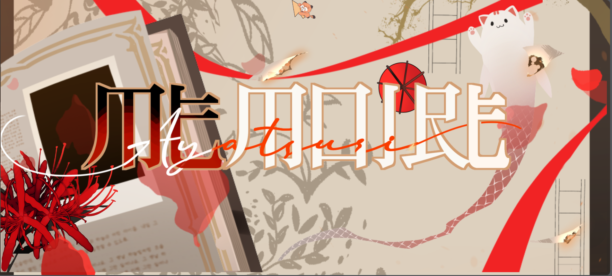

# Project_Memoire - VTuber Company Demo Page
## Overview
Project_Memoire is a demo page created for a VTuber (Virtual YouTuber) company. This README file provides essential information for developers and contributors to understand the project and how to work with it.

## Memoire Rig (AI VTuber rigging)
`rigger/` turns a single portrait photo into a live, webcam-driven VTuber avatar using the open-source LivePortrait engine. See [rigger/README.md](rigger/README.md).
