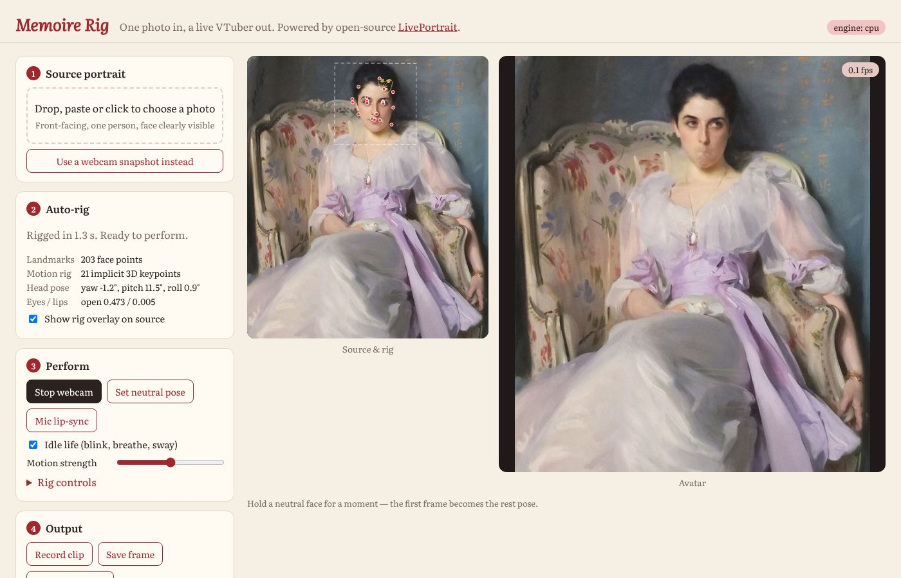
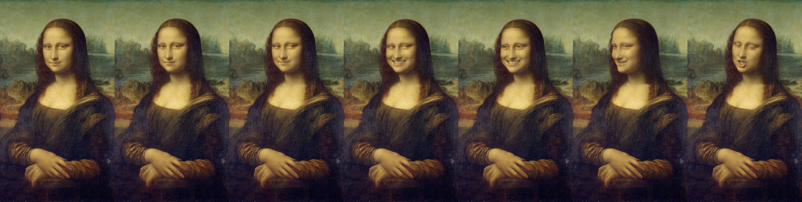

# Memoire Rig: one-photo VTuber rigging

Give it one portrait photo and it rigs it automatically. You can then puppet the avatar live from a webcam, a microphone and rig sliders, or let it idle on its own. It is built on the open-source [LivePortrait](https://github.com/KwaiVGI/LivePortrait) (MIT) neural portrait animator.



Frames below, left to right: driven by a performer video ×5; yaw + smile sliders; eyes closed + mouth open + roll sliders.



## What "auto-rig" does

When you upload a photo, the engine:

1. **Finds the face** using InsightFace detection plus LivePortrait's 203-point landmark model. It then crops and aligns the face.
2. **Builds the rig.** LivePortrait extracts a 3D appearance volume, 21 implicit 3D motion keypoints, head pose (yaw/pitch/roll), expression offsets, scale and translation.
3. **Measures the eye and lip openness** and normalises the mouth to closed, so that your neutral face maps to a neutral avatar.
4. **Prepares a paste-back mask** so the animated face blends into the full original picture, including hair, body and background.

Each frame, the rig is posed by any combination of:

| Driver | What it moves |
| --- | --- |
| **Webcam** | Head rotation and translation, every expression, blinks, gaze. Motion is relative to the neutral pose you calibrate. |
| **Mic lip-sync** | Mouth opening from voice loudness. |
| **Idle life** | Random blinks, breathing, gentle head sway, glances. Only blinks and breathing are added while the webcam is driving. |
| **Rig controls** | Yaw, pitch, roll, smile, wink, eyebrow, gaze, eye-open and mouth-open overrides. These use LivePortrait's own retargeting edits. |

## Setup

You need Python 3.10, git, and ideally an NVIDIA GPU. A GPU runs in real time; a CPU takes several seconds per frame.

```bash
conda create -n memoire python=3.10 -y && conda activate memoire
cd rigger
python setup_liveportrait.py
```

The setup script does three things:

- Clones LivePortrait into `vendor/` at a pinned commit.
- Installs PyTorch (CUDA 12.1, or CPU when no NVIDIA GPU is found) and the dependencies.
- Downloads the pretrained weights (about 500 MB) from Hugging Face.

On Apple Silicon it uses the macOS requirements and the MPS backend.

## Use

**Browser studio:**

```bash
python -m memoire_rig serve        # then open http://127.0.0.1:8765
```

Drop in a photo, click **Start webcam**, and hold a neutral face for a second. **Set neutral pose** recalibrates. **Record clip** saves a WebM and includes mic audio when lip-sync is on.

**Stream to OBS, Discord or Zoom as a virtual camera:**

```bash
python -m memoire_rig cam --source photo.jpg --virtualcam
```

On Windows and macOS, the virtual camera needs OBS installed. On Linux it needs `v4l2loopback`. In the preview window, press `c` to recalibrate and `q` to quit.

**Inspect a rig** (crop, pose, keypoints) as JSON:

```bash
python -m memoire_rig rig --source photo.jpg
```

## Anime characters

LivePortrait is trained on real faces and usually misses anime faces; in testing it locked onto a hair ornament instead of the face. For anime art, use the anime engine, built on [Talking Head Anime 3](https://github.com/pkhungurn/talking-head-anime-3-demo) by Pramook Khungurn (code MIT, models CC BY 4.0, so you must credit the author if you redistribute the models).

```bash
python setup_liveportrait.py --anime --no-pip --no-weights   # ~830 MB of models
python -m memoire_rig anime --source character.png
```

**Input:** a PNG with a transparent background and one upright, front-facing character.

**What it does:**

1. **Finds the head** with an anime face detector ([lbpcascade_animeface](https://github.com/nagadomi/lbpcascade_animeface)). If the detector isn't available, it falls back to the silhouette.
2. **Lays the character out** on THA3's 512×512 template, with the head in the 128 px box.
3. **Renders a seamless loop** using THA3's 45-parameter rig: idle sway and breathing, blinks, a few seconds of talking with vowel mouth shapes, and a smile.

**Output** goes to `renders/`:

- an MP4
- a transparent-background WebM for OBS overlays
- a GIF preview
- the laid-out rig input

**Options:**

- `--head cx,cy,size` overrides head placement.
- `--seconds` and `--fps` change the loop length and frame rate.

On CPU it runs at about 0.8 s per frame. On a GPU it is real-time.

### Expressions and accessory physics

Add an accessory rig to render an expression showreel in which the hair and ornaments have their own physics:

```bash
python -m memoire_rig anime --source character.png --accessories accessories.json
```

**Expressions.** There are nine expressions: neutral, happy, laugh, surprised, wink, smug, angry, sad and sleepy. Each one is a THA3 face preset plus its own acting: hops, a head snap, a head shake, a slow droop, or nodding off and jerking awake. The timeline blends smoothly from one to the next and adds breathing and blinks. The presets are also written out as `*_expressions.json`.

**Accessory physics.** Each accessory gets the Live2D treatment:

1. It is cut into its own layer, and the base is inpainted behind it.
2. THA3 poses the base.
3. Each layer follows the head via optical flow around its anchor, then bends as a damped pendulum chain.

The simulation runs at 10 sub-steps per frame, in the head's frame of reference. It models:

- a spring back to the drawn pose, with damping
- lag from the anchor's acceleration
- gravity pulling hanging parts toward world-down when the head tilts
- drag when the head rotates
- an optional second segment that whips, for an S-curve
- an optional axial spring, so hair stretches on landings and compresses on the rebound
- light wind

Bends are zero at the attachment and grow toward the tip, so there is no seam where a part joins the head.

`accessories.json` uses coordinates on the 512×512 layout. They are written to `*_rig_input.png`, and `*_layers.png` shows the result:

```json
{"accessories": [
  {"name": "ponytail", "segments": 2,
   "polygon": [[306,58],[332,60],[352,100],[364,160],[368,258],[322,258],[318,140]],
   "anchor": [312,78], "tip": [348,252],
   "stiffness": 4, "damping": 1.7, "gravity": 0.9, "inertia": 1.3,
   "stiffness2": 14, "damping2": 2.6, "follow": 0.7,
   "stretch_stiffness": 70, "max_stretch": 0.07, "wind": 0.25, "max_angle": 0.55},
  {"name": "leaf_ornament", "polygon": [[160,113],[200,112],[204,128],[172,140]],
   "anchor": [201,124], "tip": [162,130], "stiffness": 170, "damping": 8, "inertia": 0.55, "wind": 0.4}
]}
```

**Tuning guide:**

- **Long hair:** low `stiffness` with `gravity`, so it hangs and swings slowly.
- **Small ornaments:** high `stiffness` with low `inertia`, so they flick and settle fast.
- **More bounce:** lower `damping`.
- **Limit the swing:** use `max_angle`, in radians.

## Tips

- Use a sharp, front-facing photo with one person and the full face visible, ideally with eyes open and mouth closed.
- Keep your webcam face roughly the same size and pose as when you calibrated. Motion is relative to that pose.
- For anime or very stylised art, use the anime engine (above).

## Licensing

- LivePortrait's code is MIT licensed.
- The Talking Head Anime 3 models are CC BY 4.0, so you must credit Pramook Khungurn. The anime face detector declares no license, and it is downloaded only as an optional file.
- LivePortrait uses **InsightFace detection models, which are for non-commercial research only**. Replace them before any commercial use.
- Only animate people who have consented to it.

## Layout

```
rigger/
  setup_liveportrait.py   fetch engine + weights
  memoire_rig/
    engine.py             auto-rig, per-frame posing, expression edits, face tracker
    session.py            webcam + controls + idle autopilot -> frames
    server.py             FastAPI: /api/source upload, /ws lock-step frame stream
    anime.py              anime engine: head finding, THA3 layout, performance loop, export
    expressions.py        expression presets, acting motions, timeline, head kinematics
    physics.py            accessory layers, pendulum-chain + stretch physics, bend warp
    __main__.py           CLI: serve | cam | rig | anime
  web/                    browser studio (index.html, app.js, style.css)
```
